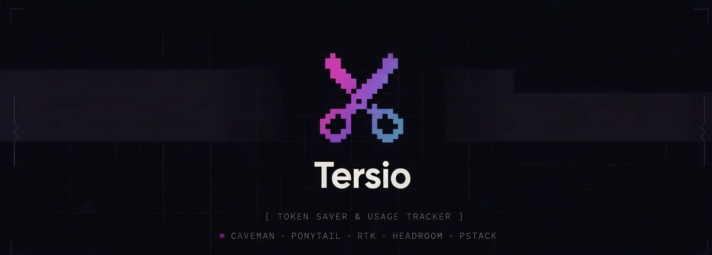

# ✂️ Tersio — Token Saver & Usage Tracker

[](https://www.npmjs.com/package/@krtclcdy/tersio)
[](https://nodejs.org)
[](https://www.npmjs.com/package/@krtclcdy/tersio)
[](https://github.com/KurutoDenzeru/tersio/actions)
[](./LICENSE)

Token saver & usage tracker for coding agents: terse caveman replies, compact RTK shell output, lean Ponytail code, pstack rigor, and a gain dashboard — one-command combos over one shared extension tree.

Measured savings per mode, the prompt overhead each one adds, and the rerun protocol: [docs/BENCHMARK_GUIDE.md](./docs/BENCHMARK_GUIDE.md).

## 🎯 What this is, and why you would use it

Coding agents bill you per token. Three of the costs you never asked for:

- **Replies carry filler.** The same three sentences, plus a greeting, a hedge, a recap, and a "hope this helps".
- **Shell output is noise.** A failing test prints hundreds of lines to reach the four that matter.
- **The rules repeat every turn.** Your agent re-reads its instructions on every single turn.

Tersio installs into Oh My Pi, pi, OpenCode, or Codex, and cuts those costs:

| Mode | What it does for you |
|---|---|
| 🪨 **Caveman** | Shorter replies. Answer first, filler gone, and code, commands, paths, and errors stay exact. |
| 🗜️ **RTK** | Condensed shell output, every signal kept. A failing test still names the test, the assertion, and the line. |
| 🧠 **Ponytail** | Leaner code. YAGNI: no feature, option, or abstraction nobody asked for, and the shortest diff that still works. |
| 🥔 **pstack** | Rigor mode. It applies a design principle when the moment fits, and owns the approach, the check, and the design. Opt-in, on its own switch. |
| 🧩 **Combo** | One command sets Caveman, RTK, and Ponytail, at three strengths. |
| 📊 **Dashboard** | What you spent, per model and per day. |

Every mode is a text block you can read in the repo. Measured savings and prompt overhead are published per mode in [docs/BENCHMARK_GUIDE.md](./docs/BENCHMARK_GUIDE.md). No total-bill claim: the tests measure reply tokens, prompt overhead, and command output only.

Use an agent daily and pay per token? This is for you. Use one a few times a week? It is not worth installing.

## ⚡ Getting Started

All install paths in one table, with update and remove commands: [INSTALL.md](./INSTALL.md).

**Default** (macOS/Linux) — one line. Installs the CLI via npm, then runs the main installer (scope + Combo preset menus) in the same pass:

```bash
curl -fsSL https://github.com/KurutoDenzeru/tersio/releases/latest/download/install.sh | sh
```

**Windows** — one line, the same pass through PowerShell:

```powershell
irm https://github.com/KurutoDenzeru/tersio/releases/latest/download/install.ps1 | iex
```

Then run the CLI. Bare `tersio` opens a menu and asks which agent to install into:

```bash
tersio                      # menu — picks Oh My Pi, pi, OpenCode, or Codex
tersio install --host pi    # pi, non-interactive
tersio install --host omp   # Oh My Pi, non-interactive
tersio install --host opencode  # OpenCode, non-interactive
tersio install --host codex # Codex plugin, non-interactive
```

Or let each host install the package itself:

```bash
omp plugin install @krtclcdy/tersio
pi install npm:@krtclcdy/tersio
opencode plugin add @krtclcdy/tersio
```

Pick one install method per host, not both. Using both registers every command twice.

The OMP, pi, and OpenCode hosts load the same six extensions. Codex loads a plugin with one prompt hook. All four hosts read their session-start defaults from `~/.tersio/settings.json`.

One-off use without installing:

```bash
npm exec --yes --prefer-online --package=@krtclcdy/tersio@latest -- tersio install
```

### Requirements

| Need | Detail |
|---|---|
| Host | [OMP](https://github.com/can1357/oh-my-pi), [pi](https://github.com/earendil-works/pi), [OpenCode](https://opencode.ai), or [Codex](https://github.com/openai/codex) — `tersio install --host <omp\|pi\|opencode\|codex>` |
| Node.js | 20.12+ with npm. The CLI runs under Node |
| Bun | Optional. Preferred when on PATH, npm otherwise; also supplies SQLite in process |
| SQLite | Bun, Node 22.5+ `node:sqlite`, or the `sqlite3` binary on PATH |
| OS | macOS, Linux, or Windows, native (`install.ps1`). WSL works too, installed from inside it |

## 🔌 MCP

`tersio mcp` speaks the Model Context Protocol, so any MCP-capable client can read Tersio's data and set its modes mid-session. Nothing to run: the client starts Tersio when it needs it and stops it when done.

Add this entry under `mcpServers` in the client's MCP settings:

```json
{
  "mcpServers": {
    "tersio": {
      "command": "tersio",
      "args": ["mcp"]
    }
  }
}
```

That is the whole setup. No extra command, no port, no token, and no process to keep alive.

Three tools become available: `tersio_stats` (requests, errors, tokens, cache rate, and cost for a range, in your display currency), `tersio_activity` (what Tersio changed, newest first), and `tersio_modes` (read the session-start defaults, or set them: a Combo preset, or any single mode — caveman, rtk, ponytail, pstack — overriding its piece of the preset).

## 🖥️ CLI

| Command | Purpose |
|---|---|
| `tersio install` | Install (user scope: all OMP sessions) |
| `tersio update` | Refresh the CLI, extensions, and add-ons (RTK binary, Caveman rule, Ponytail). A terminal asks which agent; `--host` pins it and `--yes` keeps Oh My Pi |
| `tersio doctor` | Check every host, extension, Ponytail, RTK, Codex plugin, and OpenCode service health (`--fix` repairs, `--fix=<scope>` one scope, `--dry-run` previews) |
| `tersio dashboard` | Open the Dashboard (`--open`, `--export <file>`, `--port <n>`, `--currency <code>`; serves localhost only) |
| `tersio mcp` | Start the Tersio MCP server on stdio (see [MCP](#-mcp)) |
| `tersio uninstall` | Remove extensions, registrations, the Ponytail plugin, and the `rtk.ts` OMP wiring (`--keep-ponytail` keeps Ponytail; `--remove-rtk` also removes the RTK binary) |
| `tersio version` | Print version |

Flags: `--dry-run`, `--yes`/`-y`, `--verbose`, `--combo-default`/`--caveman-default`/`--rtk-default`/`--ponytail-default`/`--pstack-default`, `--currency <code>` (usage/dashboard display currency; flag wins, then the dashboard's own default, then USD). Legacy `--doctor` / `--uninstall` forms still work.

## ⌨️ Commands reference

Mode switches live on their own commands; bare `/tersio` prints status. Every mode command, and every session start, prints the status line:

```
🧩 COMBO MAX: 🪨 caveman=ULTRA | 🗜️ rtk=ON | 🧠 ponytail=ULTRA | 🥔 pstack=ON
```

It is display-only — it never enters the model context, so it costs the session nothing.

| Command | Purpose |
|---|---|
| `/combo off\|lite\|balanced\|max\|status` | One preset for caveman, RTK, and Ponytail (start here): lite = caveman lite · rtk on · ponytail lite, balanced = full/on/full, max = ultra/on/ultra, and off disables those three; per-mode tweaks drop to `custom`. pstack is separate and no preset changes it. |
| `/caveman lite\|full\|ultra\|megacave-lite\|megacave-full\|megacave-ultra\|off\|status` | Terse replies at six levels. `full`, `ultra`, and `megacave-full` ship upstream's bodies byte for byte; `lite`, `megacave-lite`, and `megacave-ultra` are Tersio's own, for registers upstream defines but no longer ships, and each names its upstream row. Legacy `wenyan` spellings still resolve: `wenyan`/`wenyan-full` → `megacave-full`, `wenyan-lite` → `megacave-lite`, `wenyan-ultra` → `megacave-ultra`. |
| `/rtk on\|off\|status` | Controls RTK session guidance, `rtk_run`, and the automatic hook through shared `RTK_DISABLED` state. Exact bytes bypass RTK. |
| `/ponytail off\|lite\|full\|ultra\|status` | Minimal code using upstream Ponytail modes, one body at four levels. Review runs as its own skill. |
| `/pstack on\|off\|status` | Rigor mode, forked from [pstack](https://github.com/cursor/plugins/tree/main/pstack) (MIT). Opt-in: set it on its own, since no preset turns it on; `normal mode` clears it. |
| `/tersio status` | Active modes + combo level; state persists and propagates to subagents. |
| `/tersio update <ponytail\|rtk\|caveman\|all> [--dry-run]` | Update add-ons, preview with dry-run |
| `/tersio dashboard` | Open the Dashboard. |

In Codex the slash commands do not exist. The Tersio plugin ships the modes as skills instead: call `$tersio-combo`, `$tersio-caveman`, `$tersio-rtk`, `$tersio-ponytail`, or `$tersio-pstack` in the prompt, or pick them in `/skills`. The `tersio_modes` MCP tool switches a mode from a plain sentence.
| `/tersio help` | This table |

## 🗂️ Files and backups

Shared, and identical for every host:

| What | Path |
|---|---|
| Session-start defaults | `~/.tersio/settings.json` — combo, caveman, rtk, ponytail, pstack, and the display currency |
| RTK binary | `~/.bun/bin/rtk` (`rtk.exe` on Windows). The runtime resolves `PATH` first, then this managed path. |
| Usage ledger and price cache | `~/.tersio/` — local only, nothing leaves the machine |
| Session state | `~/.tersio/state.json` — reset watermark, update check and cadence, rtk heads, and the doctor report |
| Upstream scorecard | `~/.tersio/upstream/` — `scorecard.json`, `scorecard.md`, and the cached trees |
| `usage.db` host scope | `~/.tersio/usage.db` mirrors every agent Tersio reads: omp and pi transcripts, Codex rollout JSONL, the OpenCode JSON tree, and the OpenCode v2 sqlite rows. Each row records its host and its agent kind, so a report splits by agent and by main agent or subagent. |
| Model prices | `~/.tersio/prices.json` caches LiteLLM's feed; `~/.tersio/prices.local.json` is yours, keyed by model id or a `*` gateway prefix, and it wins over the feed. A model the list does not know reads as an estimate, and the Models page counts those requests as unpriced. |
| Price sources | The host's own reported cost first, then `prices.local.json`, then the LiteLLM cache, then a default table the report labels a guess. A recorded zero is a real zero. A model counts as host-priced only when every message carried a cost. |
| Data snapshots | `~/.tersio/backups/` — one `.snap` file per snapshot, checked against its own hash, six kept |

Per host, written by `tersio install --host <omp|pi|opencode|codex>`:

| Host | Extensions | Ponytail |
|---|---|---|
| Oh My Pi | `~/.omp/plugins/node_modules/@krtclcdy/tersio/extensions/` — loaded from the plugin manifest, so the agent tree keeps only rtk's `extensions/rtk.ts` wiring | vendored at `extensions/ponytail/`, so **Settings → Plugins** lists one row |
| pi | `~/.pi/agent/extensions/{caveman,pstack,rtk,combo,commands,updater}/` — pi auto-discovers `<agent-dir>/extensions`, so there is nothing to register | `~/.pi/agent/ponytail/`, a local package written from Tersio's vendored copy |
| OpenCode | `~/.config/opencode/plugins/tersio/` — registered in `opencode.json` plugins, so there is nothing else to register | bundled with Tersio; no separate package |
| Codex | `~/.codex/plugins/cache/tersio/tersio/<version>/` from the repo marketplace, or `~/.tersio/codex-plugin/` for the local fallback | bundled in the fallback; the marketplace plugin calls the installed Tersio CLI |

Tersio is agent-neutral: the OMP, pi, and OpenCode hosts load the same six extensions and the same `shared/` modules. Codex loads the mode context from one prompt hook. Only the paths and the registration differ, and the installer owns those. OMP is one host of four, not the target.

Per host, in more words:

- **OMP.** The plugin manifest and the extension dir OMP discovers by default merge, so Tersio keeps one copy of each file and clears what an older build left in `~/.omp/agent/extensions/`. A second copy would load twice, and one of the two cannot resolve its own rule bodies. The install also registers the package in `~/.omp/plugins`, so it shows under **Settings → Plugins**.
- **pi and OpenCode.** Nothing to register beyond what their own install command does, so the table above is the whole story.
- **Codex.** The installer adds the repo marketplace and installs `tersio@tersio`. If that source is unavailable, it writes a self-contained plugin and a personal marketplace. Review the Tersio hook in Codex `/hooks` before use.

The installer writes `<file>.bak` before it replaces a source. `tersio doctor --fix extensions` restores a damaged tree, and `doctor --fix registrations` drops retired or duplicate `config.yml` entries.

Settings -> **Data** holds the snapshots and the reset. A restore snapshots the current state first, then copies the chosen one over the live files; it never deletes, and a delete never touches the live data. Both ask first and name what they move, and a file a snapshot does not hold is left alone. The same pane clears the statistics behind a confirmation that names the ledger and RTK rows it would take, then empties the ledger and hides what it summarised. Session transcripts, rtk history, and prices stay on disk.

Active modes reassert after Ponytail's prompt block on every top-level turn, including after history compaction.

## 🛠️ Troubleshooting

**Ponytail or Combo command missing on OMP:** confirm `~/.omp/plugins/package.json` lists `@krtclcdy/tersio`, then run `tersio install`, restart OMP, and check `tersio doctor`. A damaged tree is repaired by `tersio doctor --fix extensions`.

**RTK missing or not executable:** run `tersio install`, then `tersio doctor`. On Linux/macOS: `chmod +x ~/.bun/bin/rtk`. On Windows the binary is `rtk.exe`, and rtk publishes no `aarch64-pc-windows` build, so a Windows-on-ARM host has no rtk to install. The doctor's Platform row names this directly.

**RTK savings and adoption:** the Gain numbers read rtk's own `history.db` (`%LOCALAPPDATA%\rtk` on Windows), so pi and OpenCode runs are already in them. The adoption row counts executed Bash calls from the omp and pi transcripts and OpenCode's v2 sqlite or pre-v2 JSON tree. The eligible list comes from `rtk rewrite`, cached per binary version. Native tool calls (`read`/`edit`/`eval`) and exact bytes bypass RTK.

**Checksum warning or failure:** the installer aborts on RTK checksum mismatch but warns and continues when checksum metadata is unavailable; `/tersio update rtk` aborts when metadata is missing.

**Codex mode block missing:** run `tersio doctor`, then `tersio doctor --fix codex`. Restart Codex and trust the Tersio hook in `/hooks`. Codex does not run an untrusted plugin hook.

## 🤝🏻 Contributing

Contributions are always welcome, whether you're fixing bugs, improving docs, or shipping new features that make the project better for everyone.

Check out [CONTRIBUTING.md](CONTRIBUTING.md) to learn how to get started and follow the recommended workflow.

## ⚖️ License

This project is released under the MIT License, giving you the freedom to use, modify, and distribute the code with minimal restrictions.

For the full legal text, see the [LICENSE](LICENSE) file.
