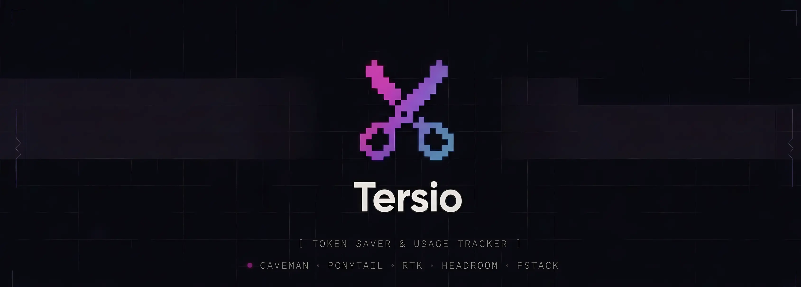
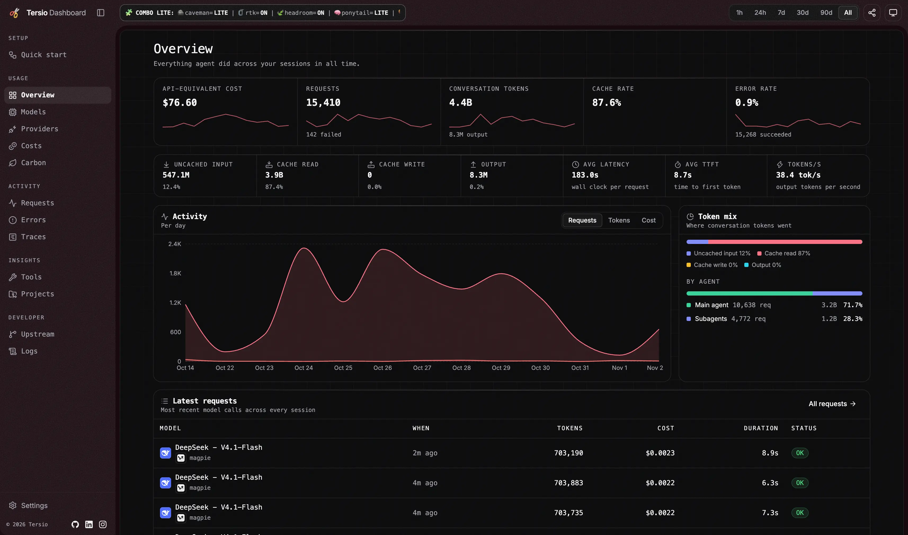

# ✂️ Tersio — Token Saver & Usage Tracker

[](https://www.npmjs.com/package/@krtclcdy/tersio)
[](https://nodejs.org)
[](https://www.npmjs.com/package/@krtclcdy/tersio)
[](https://github.com/KurutoDenzeru/tersio/actions)
[](./LICENSE)

Token saver & usage tracker for coding agents: terse caveman replies, compact RTK shell output, lean Ponytail code, Headroom compression, pstack rigor, and a gain dashboard — one-command combos over one shared extension tree.


## 🎯 What this is, and why you would use it

Coding agents bill you per token. Three of the costs you never asked for:

- **Replies carry filler.** The same three sentences, plus a greeting, a hedge, a recap, and a "hope this helps".
- **Shell output is noise.** A failing test prints hundreds of lines to reach the four that matter.
- **The rules repeat every turn.** Your agent re-reads its instructions on every single turn.

Tersio installs into Oh My Pi, Pi, Pi-in-go, OpenCode, and DeepSeek Harness, and cuts those costs:

| Mode | What it does for you |
|---|---|
| 🪨 **Caveman** | Shorter replies. Answer first, filler gone, and code, commands, paths, and errors stay exact. |
| 🗜️ **RTK** | Condensed shell output, every signal kept. A failing test still names the test, the assertion, and the line. |
| 🧠 **Ponytail** | Leaner code. YAGNI: no feature, option, or abstraction nobody asked for, and the shortest diff that still works. |
| 🥔 **pstack** | Rigor mode. It applies a design principle when the moment fits, and owns the approach, the check, and the design. Opt-in, on its own switch. |
| 🍃 **Headroom** | Headroom shrinks tool output, file reads, and history. Opt-in; Tersio reads its savings and never turns it on for you. |
| 🧩 **Combo** | One command sets Caveman, RTK, and Ponytail, at three strengths. |
| 📊 **Dashboard** | What you spent, per model and per day. |

## ⚡ Getting Started

All install paths in one table, with update and remove commands: [INSTALL.md](./INSTALL.md).

**Default** (macOS/Linux) — one line. Installs the CLI via npm, then runs the main installer (scope + Combo preset menus) in the same pass:

```bash
curl -fsSL https://github.com/KurutoDenzeru/tersio/releases/latest/download/install.sh | sh
```

**Windows** — one line, the same pass through PowerShell:

```powershell
irm https://github.com/KurutoDenzeru/tersio/releases/latest/download/install.ps1 | iex
```

Then run the CLI. Bare `tersio` opens a menu and asks which agent to install into:

```bash
tersio                      # menu — picks Oh My Pi, pi, OpenCode, Pi-in-go, or DeepSeek Harness
tersio install --host pi    # pi, non-interactive
tersio install --host omp   # Oh My Pi, non-interactive
tersio install --host opencode  # OpenCode, non-interactive
tersio install --host pig   # Pi-in-go (PiG), non-interactive
tersio install --host dsh   # DeepSeek Harness — mounts the bundle into every dsh profile
```

Or let each host install the package itself:

```bash
omp plugin install @krtclcdy/tersio
pi install npm:@krtclcdy/tersio
opencode plugin add @krtclcdy/tersio
pig install npm:@krtclcdy/tersio
dsh plugin --profile web add npm:@krtclcdy/tersio
```

The DeepSeek Harness desktop app installs through its Plugins pane instead: **Add plugin** → paste `@krtclcdy/tersio`, or a local checkout path while the bundle field is unreleased → restart the app. `dsh plugin` refuses the `desktop` profile by design, and `tersio install --host dsh` never writes it.

Pick one install method per host, not both. Using both registers every command twice.

All hosts load the same six extensions from the same sources and read their session-start defaults from `~/.tersio/settings.json`. All six load always.

One-off use without installing:

```bash
npm exec --yes --prefer-online --package=@krtclcdy/tersio@latest -- tersio install
```

### Requirements

| Need | Detail |
|---|---|
| Host | [OMP](https://github.com/can1357/oh-my-pi), [pi](https://github.com/earendil-works/pi), [OpenCode](https://opencode.ai), [PiG](https://pi-in-go.dev), or [DeepSeek Harness](https://github.com/deepseek-ai/deepseek-harness) — `tersio install --host <omp\|pi\|opencode\|pig\|dsh>` |
| Node.js | 20.12+ with npm. The CLI runs under Node |
| Bun | Optional. Preferred when on PATH, npm otherwise; also supplies SQLite in process |
| SQLite | Bun, Node 22.5+ `node:sqlite`, or the `sqlite3` binary on PATH |
| OS | macOS, Linux, or Windows, native (`install.ps1`). WSL works too, installed from inside it |

## 📊 Dashboard

`tersio dashboard` opens a local page for usage, cost, tools, traces, and savings. Other pages cover Models, Providers, Costs, Carbon, Requests, Errors, Tools, and Projects.

**Quick start (Recommended)** is the place to see the whole setup workflow: the modes, the agents, and how one turn moves from prompt to output.


**Overview** shows spend, requests, tokens, cache rate, and the latest calls.



## 🧪 Benchmarks

One model, `GLM-5.3-Flash`, five runs per prompt. Method: [docs/BENCHMARK.md](./docs/BENCHMARK.md).

| Case | Reply Δ% | Δ Net | Quality | Agentic Δ% | Wall Δ |
|---|---:|---:|---:|---:|---:|
| Base | 0 | 0 | 11/15 | 0 | 0 |
| Caveman `lite` | -10.9% | +1,044 | 8/15 | — | — |
| Caveman `full` | -8.4% | +1,182 | 8/15 | — | — |
| Caveman `ultra` | -15.1% | +612 | 12/15 | — | — |
| Caveman `megacave-lite` | +8.4% | +817 | 2/15 | — | — |
| Caveman `megacave-full` | +58.0% | +844 | 0/15 | — | — |
| Caveman `megacave-ultra` | +46.2% | +789 | 4/15 | — | — |
| Ponytail `lite` | +20.6% | -70 | 13/15 | — | — |
| Ponytail `full` | +11.2% | +188 | 12/15 | — | — |
| Ponytail `ultra` | +28.4% | +302 | 12/15 | — | — |
| pstack `on` | — | — | 5/5 | +17.9% | -4.3s |
| RTK `on` | -79.5% find, -10.5% grep | — | 3/3 | +152.3% | +108.5s |
| Headroom `on` | -94.9% payload | — | sentinel | — | — |
| Combo `lite` | -16.0% | +1,743 | 5/15 | -27.8% | -18.8s |
| Combo `balanced` | -0.8% | +1,882 | 10/15 | -3.1% | +46.1s |
| Combo `max` | +6.7% | +1,343 | 8/15 | -31.5% | -19.2s |
| Combo + Headroom `lite` | -13.4% | +1,744 | 9/15 | +10.6% | +103.7s |
| Combo + Headroom `balanced` | -7.6% | +1,874 | 9/15 | -27.6% | -12.2s |
| Combo + Headroom `max` | +0.8% | +1,333 | 12/15 | -20.0% | -20.9s |
| Combo + pstack `lite` | -0.8% | +5,337 | 9/15 | +1.9% | -27.2s |
| Combo + pstack `balanced` | -7.6% | +5,452 | 6/15 | +45.1% | +6.7s |
| Combo + pstack `max` | +0.8% | +4,909 | 9/15 | +15.2% | -22.0s |
| Combo + all `lite` | -3.4% | +5,334 | 9/15 | +20.3% | -13.9s |
| Combo + all `balanced` | -13.4% | +5,445 | 8/15 | +5.7% | +2.9s |
| Combo + all `max` | -12.6% | +4,896 | 10/15 | -16.6% | -25.1s |

Base: 119 reply tokens, 1,616 total, 11 of 15. Agentic base: 40,176 tokens at 135.5s (pstack, RTK) and 70,784 at 150.3s (combo stacks). Agentic rows rest on 1 to 5 runs, so read them as smoke tests; no bill savings are claimed. Per-mode files: [Caveman](./docs/BENCH_CAVEMAN.md), [Ponytail](./docs/BENCH_PONYTAIL.md), [pstack](./docs/BENCH_PSTACK.md), [RTK](./docs/BENCH_RTK.md), [Headroom](./docs/BENCH_HEADROOM.md), [Combo](./docs/BENCH_COMBO.md), [Combo + Headroom](./docs/BENCH_COMBO_HEADROOM.md), [Combo + pstack](./docs/BENCH_COMBO_PSTACK.md), [Combo + all](./docs/BENCH_COMBO_ALL.md).

## 🔌 MCP

`tersio mcp` speaks the Model Context Protocol, so any MCP-capable client can read Tersio's data and set its modes mid-session. Nothing to run: the client starts Tersio when it needs it and stops it when done.

Add this entry under `mcpServers` in the client's MCP settings:

```json
{
  "mcpServers": {
    "tersio": {
      "command": "tersio",
      "args": ["mcp"]
    }
  }
}
```

That is the whole setup. No extra command, no port, no token, and no process to keep alive. `tersio install` writes this same Tersio server entry into OMP, Pi, PiG, and OpenCode, and asks first — the prompt reads `Add the Tersio MCP server to <agent>? … (optional)`, so a machine that should stay untouched can decline. DeepSeek Harness needs no file: its bundle patch carries the entry, and it is wired as soon as the plugin is mounted.

The entry names an absolute `tersio` path when the binary is findable at install time, because an agent launched from the desktop never reads a shell profile and would not see the bare name. The bare name stays as the fallback.

Six tools become available: `tersio_stats` (requests, errors, tokens, cache rate, and cost for a range, in your display currency), `tersio_activity` (what Tersio changed, newest first), `tersio_hosts` (every supported agent, its installed version, and whether the MCP entry reaches it), `tersio_sessions` (the newest sessions with host, project, model, tokens, and cost), `tersio_modes` (read the session-start defaults, or set them: a Combo preset, or any single mode — caveman, rtk, ponytail, pstack, headroom — overriding its piece of the preset; pass `host` to scope the read or the write to one agent), and `tersio_headroom` (savings by default; `action: status` for live proxy counters and routing; `action: retrieve` with a marker hash; or `action: memory`, `evals`, and `dashboard` for the upstream commands Tersio does not reimplement).

Two resources read without spending a tool call: `tersio://settings` (the stored profile) and `tersio://hosts` (the host table with live state). A client that cancels a request stops the tool with it, so a long `evals` run does not keep the process busy after the call is gone.

## 🖥️ CLI

| Command | Purpose |
|---|---|
| `tersio install` | Install (user scope: all OMP sessions) |
| `tersio update` | Update the Tersio CLI. `--host <agent>` also refreshes that agent's extensions and add-ons (Caveman rule, Headroom, Ponytail) and reports a newer rtk release; no prompt is asked |
| `tersio doctor` (Defaults row) | `tersio doctor` prints the shared defaults and each agent's overrides, so a value's source is visible without reading the store |
| `tersio doctor` | Check OMP, extension, Ponytail, RTK, and OpenCode service health (`--fix` repairs, `--fix=<scope>` one scope, `--dry-run` previews) |
| `tersio dashboard` | Open the Dashboard (`--open`, `--export <file>`, `--port <n>`, `--currency <code>`; serves localhost only) |
| `tersio mcp` | Start the Tersio MCP server on stdio (see [MCP](#-mcp)) |
| `tersio uninstall` | Remove extensions, registrations, the Ponytail plugin, and the `rtk.ts` OMP wiring (`--keep-ponytail` keeps Ponytail; `--remove-rtk` also removes that wiring, never the binary) |
| `tersio version` | Print version |

Flags: `--dry-run`, `--yes`/`-y`, `--verbose`, `--combo-default`/`--caveman-default`/`--rtk-default`/`--ponytail-default`/`--pstack-default`/`--headroom-default`, `--currency <code>` (usage/dashboard display currency; flag wins, then the dashboard's own default, then USD). Legacy `--doctor` / `--uninstall` forms still work.

## ⌨️ Commands reference

Mode switches live on their own commands; bare `/tersio` prints status. Every mode command, and every session start, prints the status line:

```
🧩 COMBO MAX: 🪨 caveman=ULTRA | 🗜️ rtk=ON | 🍃 headroom=ON | 🧠 ponytail=ULTRA | 🥔 pstack=ON
```

It is display-only — it never enters the model context, so it costs the session nothing.

| Command | Purpose |
|---|---|
| `/combo off\|lite\|balanced\|max\|status` | One preset for caveman, RTK, and Ponytail. pstack and headroom stay separate. |
| `/caveman lite\|full\|ultra\|megacave-lite\|megacave-full\|megacave-ultra\|off\|status` | [Caveman](https://github.com/JuliusBrussee/caveman) reply levels. Legacy `wenyan` names still work. |
| `/rtk on\|off\|status` | [RTK](https://github.com/rtk-ai/rtk) shell output. Exact bytes skip it. |
| `/ponytail off\|lite\|full\|ultra\|status` | [Ponytail](https://github.com/DietrichGebert/ponytail) code levels. |
| `/pstack on\|off\|status` | [pstack](https://github.com/cursor/plugins/tree/main/pstack) rigor mode. Opt-in; `normal mode` clears it. |
| `/headroom on\|off\|status` | [Headroom](https://github.com/headroomlabs-ai/headroom) compression. Opt-in; Tersio reads its savings and never installs it silently. |
| `/tersio status` | Active modes and combo level. |
| `/tersio update <ponytail\|rtk\|caveman\|all> [--dry-run]` | Update add-ons. |
| `/tersio dashboard` | Open the dashboard. |
| `/tersio help` | This table. |

## 🗂️ Files and backups

Shared, and identical for every host:

| What | Path |
|---|---|
| Session defaults | `~/.tersio/settings.json` — combo, caveman, rtk, ponytail, pstack, headroom, and currency. `hosts.<agent>` overrides one agent; `inherit` restores the shared value |
| RTK binary | Not Tersio's: whatever `rtk` resolves to on `PATH` (or `~/.bun/bin`). rtk installs and updates it |
| Ledger and caches | `~/.tersio/usage.db` — usage rows, prices, scorecard, state, Headroom records, and layout. Local only |
| Activity log | `~/.tersio/activity.jsonl` — one line per change, as the Logs page reads it |
| Host scope | The same `usage.db` mirrors omp, pi, and OpenCode sessions, split by host and agent kind |
| Snapshots | `~/.tersio/backups/` — one hashed `.snap` each, fourteen kept, carrying `usage.db` whole |

The installer writes `<file>.bak` before it replaces a source. `tersio doctor --fix extensions` restores a damaged tree, and `doctor --fix registrations` drops retired or duplicate `config.yml` entries.

Settings → **Data** holds snapshots, the backup schedule, retention (7 days to Forever; older usage rows drop on the next sync; transcripts stay), and Reset behind Advanced. Restore saves the current state first, then copies the snapshot over the live files; delete never touches live data. Both ask first, name what they change, and leave files outside the snapshot untouched. Reset confirms, clears the ledger and its RTK rows, hides the summary, and keeps transcripts, rtk history, and prices.

Active modes reassert after Ponytail's prompt block on every top-level turn, including after history compaction.

## 🛠️ Troubleshooting

**Ponytail or Combo command missing on OMP:** confirm `~/.omp/plugins/package.json` lists `@krtclcdy/tersio`, then run `tersio install`, restart OMP, and check `tersio doctor`. A damaged tree is repaired by `tersio doctor --fix extensions`.

**RTK missing:** `tersio install` offers rtk's own quick install behind one prompt — `curl -fsSL https://raw.githubusercontent.com/rtk-ai/rtk/master/install.sh | sh` on macOS/Linux, `winget install rtk-ai.rtk` on Windows — then binds it, reading `~/.local/bin` even before your shell picks it up. Decline and it prints rtk's install page — [rtk-ai.app/docs/getting-started/installation](https://www.rtk-ai.app/docs/getting-started/installation/) — and finishes everything else.

**RTK savings and adoption:** the Gain numbers read rtk's own `history.db` (`%LOCALAPPDATA%\rtk` on Windows), so pi and OpenCode runs are already in them. The adoption row counts executed Bash calls from the omp and pi transcripts and OpenCode's v2 sqlite or pre-v2 JSON tree. The eligible list comes from `rtk rewrite`, cached per binary version. Native tool calls (`read`/`edit`/`eval`) and exact bytes bypass RTK.

**RTK update available:** `tersio update` and the dashboard report the version rtk upstream ships. Tersio never installs it; update rtk with its own installer.

## 🤝🏻 Contributing

Contributions are always welcome, whether you're fixing bugs, improving docs, or shipping new features that make the project better for everyone.

Check out [CONTRIBUTING.md](CONTRIBUTING.md) to learn how to get started and follow the recommended workflow.

## ⚖️ License

This project is released under the MIT License, giving you the freedom to use, modify, and distribute the code with minimal restrictions.

For the full legal text, see the [LICENSE](LICENSE) file.
