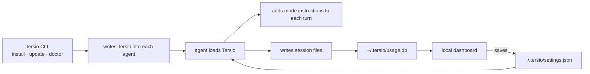
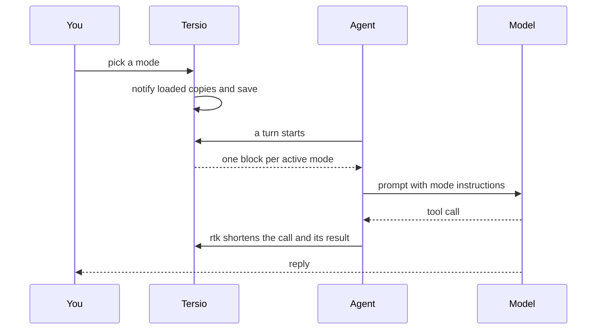
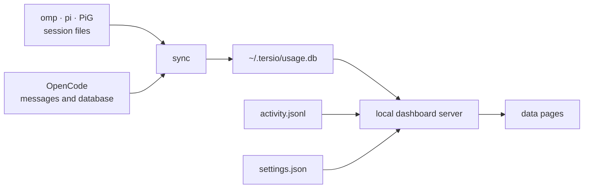
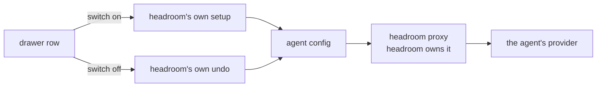

# Architecture

Tersio has two parts. The CLI installs and repairs. The plugin runs inside an agent. A local dashboard shows what the agents did.

## The parts

- **One release covers both parts.** The installed plugin and the CLI share a version.
- **The plugin starts no background service.** It runs only while the agent runs.
- **The dashboard mostly reads.** It writes saved mode defaults, its own layout and update preferences, and Headroom's setup through Headroom's own commands.

## How the plugin works

An agent loads the plugin at startup. A mode is one switch that changes one part of the work. Before each turn, the plugin adds one short instruction block for each active mode. The agent sends those instructions with your prompt. When the reply ends, the plugin waits for the next turn.

Inside the agent, a switch updates the running session and every loaded copy at once. The session record keeps the choice. The dashboard instead writes a saved default, which an agent reads when a session starts. Nothing restarts.

Say you pick `/combo balanced` and ask a question. Tersio saves the choice. At the next turn it adds the active blocks. A voice mode sets the reply style, an approach mode picks the checks, a tool mode shortens shell output, and a size mode caps the change. The model reads them with your request. The reply follows the same modes.

| Load order | Mode | What it controls | Plain effect |
|---|---|---|---|
| 1 | 🪨 caveman | Voice | Terse replies; code, paths, and errors stay exact |
| 2 | 🥔 pstack | Approach | Picks the playbook, the checks, and the design |
| 3 | 🍃 headroom | Transport | Tells the model how to recover compressed detail |
| 4 | 🗜️ rtk | Tool output | Rewrites shell commands and shortens what comes back |
| 5 | 🧠 ponytail | Size | Keeps the change as small as the task allows |

- **Load order is not priority.** No mode reads another mode's text. An inactive mode adds no block.
- **The blocks describe roles.** Caveman owns how a reply reads. Ponytail owns how much changes. Pstack owns the checks.
- **A switch replaces its own block.** Two levels of the same mode never stack.
- **Headroom adds nothing unless its runtime answers.** An undelivered promise would read as an active mode.

## The dashboard

- **One store feeds every page.** Overview, Models, Providers, Costs, Carbon, Requests, Errors, Traces, Tools, and Projects read the same store.
- **The server syncs before it reads.** A 15-second throttle keeps a page current without rereading every transcript on each poll.
- **History survives schema changes.** A new column backfills in place. An additive change never forces a rebuild from rotated transcripts.
- **Agent files stay agent-owned.** Tersio reads them and never writes to them. Reset statistics writes a watermark, not a delete.
- **Some facts stay with their source.** The omp quota view reads omp's own database. A trace reads the session file, because the store keeps facts, not message bodies.
- **Per-request savings have a defined baseline.** Requests and the request drawer compare the recorded API-equivalent cost with the same request's cache-read tokens priced at the full input rate. Output and cache-write costs stay unchanged, so this is a cache-read discount estimate, not a reconstruction of an uncompressed prompt or a provider invoice. Unknown model rates have no comparison; zero-cost requests never receive hypothetical savings. Headroom's aggregate savings are not attributed to individual requests without a matching record.
- **One activity log, two writers.** The CLI and the dashboard append to `~/.tersio/activity.jsonl`, so a terminal install appears on the Logs page.

## CodeGraph

CodeGraph is the code map Tersio installs. It reads your project once, remembers every name, who calls it, and what it depends on, and keeps that map current while you work. The agent then asks what a change touches instead of reading whole files.

- **One download per machine, not per project.** Tersio fetches the official package for your computer, checks that it works, and keeps it under `~/.tersio/codegraph/bundles`. A copy you installed yourself stays where it is.
- **The heavy work stays out of the agent.** A helper program owns the map and the file watching, so the agent's own runtime never carries the parsing code. When a session closes, its helper closes with it.
- **A session can install it in the background.** The first session that needs it fetches the package and builds the map without a prompt.
- **Update and uninstall are yours to ask for.** `tersio update` compares the installed package with npm and installs a newer one. Uninstalling Tersio removes the Tersio files but leaves the downloaded package and your project maps in place.
- **One switch per agent, one timer for all.** OMP, pi, PiG, and OpenCode get the map by default; Codex, Claude Code, and DeepSeek Harness reach it through Tersio's MCP server instead. The interval is shared: live watches files, the timers check on a clock, manual waits until you ask.
- **The dashboard touches only its own project.** Indexing and sync accept requests from this machine for the folder the dashboard runs in.
- **Tersio adds no language rules of its own.** Which languages the map reads is the upstream package's job.

## Headroom

Headroom is a separate tool that compresses tool output, file reads, and history before a turn reaches the model. Tersio writes the same configuration headroom writes, through headroom's own commands. A switch starts headroom's runtime first, so an agent never points at a dead port. Headroom still owns the proxy and its settings.

- **Only Tersio's supported agents appear.** Extra Headroom tools never enter the drawer. A present agent without its Tersio tree reads as `Tersio missing` and offers Install. An absent agent reads as `not installed` with no switch.
- **The runtime comes before the switch.** Tersio starts headroom's saved deployment, or headroom's proxy when none exists, and waits for health. Dashboard start restores an enabled runtime. The Tools page also carries a Start Headroom action.
- **Each writer owns its undo.** OMP provider overrides use Tersio's upstream markers. Pi, PiG, OpenCode, and DeepSeek Harness use Tersio's native route records. Codex and Claude Code retain their Headroom-specific setup paths.
- **A row states its own path.** A switch means a durable setup Tersio manages. `headroom install` means headroom's installer owns it. `routed by hand` means an endpoint Tersio found but cannot undo. `session only` means no durable setup exists.
- **No wrapper process per session.** Runtime hooks update model metadata rather than launching `headroom wrap` for every agent.
- **Persistent routes keep their service.** Session startup and each provider attempt ensure proxy readiness. Closing an agent releases its lease without stopping a process that configured endpoints still reference. An existing healthy shared proxy is never restarted to change another provider's upstream.
- **Undo belongs to the writer.** Headroom's own writers use `headroom unwrap`; Tersio's route writer restores the endpoint it saved.
- **The live model owns the request.** OMP hooks read `ctx.models.current()` or the request's `ctx.model`, including manual switches and native fallback events. `pi.setModel` applies the proxy endpoint and composed headers while preserving other metadata and thinking settings. An unknown original upstream or an unavailable proxy stops preparation instead of merely reporting an unrouted model.
- **Upstreams are request-local.** `x-headroom-base-url` selects the original provider without repointing the shared process. OpenAI uses the proxy's `/v1` base; Anthropic and Gemini CLI use its root. Existing authentication headers and asynchronous header resolvers survive the override. Private upstreams require Headroom's explicit upstream allowlist.
- **Codex OAuth is not an OpenAI API key.** OMP's `openai-codex-responses` uses the proxy's `/v1/codex/responses` alias. Headroom recognizes the ChatGPT account header or OAuth claim and selects `chatgpt.com/backend-api/codex/responses` independently of the configured OpenAI upstream. CommandCode therefore keeps its own upstream when the session switches to Codex.
- **Original endpoints are recoverable.** Tersio reads both legacy YAML-key and comment upstream markers, preserves model-specific URLs separately, and restores only endpoints still pointing at its proxy. Catalog recovery prefers the exact provider deterministically and excludes proxy URLs as upstreams.
- **The proxy is started directly, never through `install start`.** That command keeps a second Python process alive for the life of the proxy, about 82MB to forward one start. Tersio reuses the saved deployment's flags and spawns `headroom proxy` itself; headroom's launcher is the fallback when the direct start does not answer.
- **A built-in provider is read, not guessed.** When the active model names a provider the agent keeps in its own catalog, Tersio takes the endpoint from that catalog: omp's `models.db` or Pi's `models-store.json`. The switch then routes the provider like any other, so a host with no block still gets one route, not a hand edit.
- **The route record is the undo.** Tersio stores the file, provider, old URL, and written URL. The off switch restores the old URL only while the file still holds the written URL, so a newer edit survives.
- **Retrieval is Tersio's.** A compression marker carries a hash. Tersio installs one MCP entry (`tersio mcp`) for every host it supports; `tersio_headroom` with `action: retrieve` reads the original from the proxy's store.
- **The pill states configuration, the counters state traffic.** `/stats` supplies requests, compressed requests, and live tokens saved; the durable ledger supplies lifetime savings.

## Setup, update, and health

- **One host table names every capability.** `extensions/shared/host-caps.ts` owns labels, commands, MCP shape, RTK binding, and Headroom support. Install, uninstall, MCP, and RTK read it instead of repeating host conditionals.
- **Codex is a plugin, not an extension tree.** `plugins/tersio/plugin.json` carries the manifest, `mcp.json` carries the server, per-mode `skills/` provide the composer shortcuts, and `hooks/hooks.json` applies literal `/combo`, `/caveman`, and `/ponytail` commands to a per-`session_id` overlay before injecting those modes into later prompts. `tersio install --host codex` materializes a local marketplace with absolute command paths, writes `/prompts:*` fallbacks under `$CODEX_HOME/prompts/`, and manages the plugin lifecycle. Codex exposes no plugin API for native slash autocomplete.
- **Claude Code is a plugin whose mod draws and injects.** `plugins/claude/` carries the manifest, `hooks/hooks.json`, and a typed `hooks/register.ts` that runs *inside* Claude Code: the combo line sits in the `AbovePrompt` band and costs no rows when every mode is off, and `prompt.submit` attaches the active Caveman, Ponytail, and pstack bodies as context. Headroom's recovery block rides only while the endpoint is routed. `commands/*.md` is what puts the entries in the slash menu, because a name passed to `$.command.register` answers when typed but never appears there. The loader statically rejects a mod that imports `node:fs`, or that hands the API object to a helper; both are why each hook does its own read.
- **Claude sessions are read like every other host.** `~/.claude/projects/<slug>/<session>.jsonl` joins `sessionsDirs()`, `hostOfSessionFile()` maps that tree to `claude`, and `normaliseUsage()` translates Claude's snake_case token buckets at the parse boundary. Without the last one the rows parse with a model and zero tokens.
- **Codex rollout files are the usage source.** `extensions/shared/codex-transcript.ts` folds `session_meta`, `turn_context`, completed command and patch items, MCP calls, token records, and task timing into the same request rows every dashboard page reads. The session's real `cwd` drives Projects and Traces; Codex's date-based `sessions/<year>/<month>/<day>/` path is never mistaken for a subagent tree.
- **rtk's binary is rtk's.** Tersio detects the binary and runs rtk's own `rtk init` binding; it never downloads, replaces, or deletes it. Install, `doctor --fix`, the updater, and uninstall all stop at detection and wiring, so a user's own rtk install is never overwritten or removed.
- **Install writes one tree per agent and one manifest.** A second copy of the same file is treated as the bug.
- **Doctor repairs or names the cleanup.** A partial tree reads as not installed. Legacy entries are removed.
- **Update checks two sources.** The npm registry and the GitHub release feed are read together, and the newer version wins.
- **The server owns the clock.** The page sends durations, not timestamps, so a waking laptop cannot show a stale window.
- **Nothing installs without a click.** Update now spawns `tersio update --yes` and prints the child's output.

Caveman, pstack, ponytail, and rtk are ports. `cli/upstream.ts` records a pin for each source and compares the local files with that pin. `tersio upstream` is a hidden engineering check: it reports gaps, separates reviewed drift from new drift, and writes Markdown only when `--md` names a file. No scheduled job runs it.

## MCP

`tersio mcp` serves the Model Context Protocol over stdio. Any compatible client can read Tersio's numbers and set its mode defaults.

- **The client starts it.** There is no daemon, port, or token.
- **It reads the same store as the dashboard.** A dashboard figure and an MCP figure are the same figure.
- **Its write path matches Settings.** A mode change lands in `settings.json` and in the activity log. A `host` argument writes that agent's own `hosts.<id>` section instead, which is the same section the dashboard and `tersio install` write.
- **stdout carries only the protocol.** Settings output is captured and returned as the tool's answer.
- **The entry belongs to the host, not to this process.** `tersio install` asks before writing it, except for DeepSeek Harness and Codex, whose plugin bundles carry it. The written command is an absolute path when the binary resolves, because a desktop-launched agent inherits no shell PATH.
- **A `.jsonc` config is edited in place.** Only the `mcp` block is spliced, so the user's comments and layout survive a write that a JSON round-trip would flatten.
- **Resources are static snapshots.** `tersio://settings` and `tersio://hosts` read on demand; there is no subscription or change notification.

## Limits

- **The shared state is process-wide.** One process serving two sessions would share it. The supported hosts run one user and one session per process.
- **Prompt blocks append.** A mode change replaces its own old block, but no extension can rewrite another mode's prompt text.
- **Agent detection is mostly by name.** An agent that rewrites its subagent prompt loses that detection silently.
- **A store from a newer Tersio is kept.** The older build skips the re-parse, because rotated transcripts cannot rebuild it.
