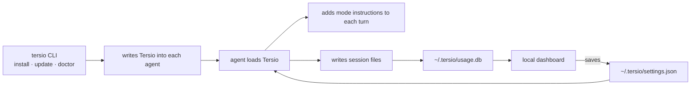
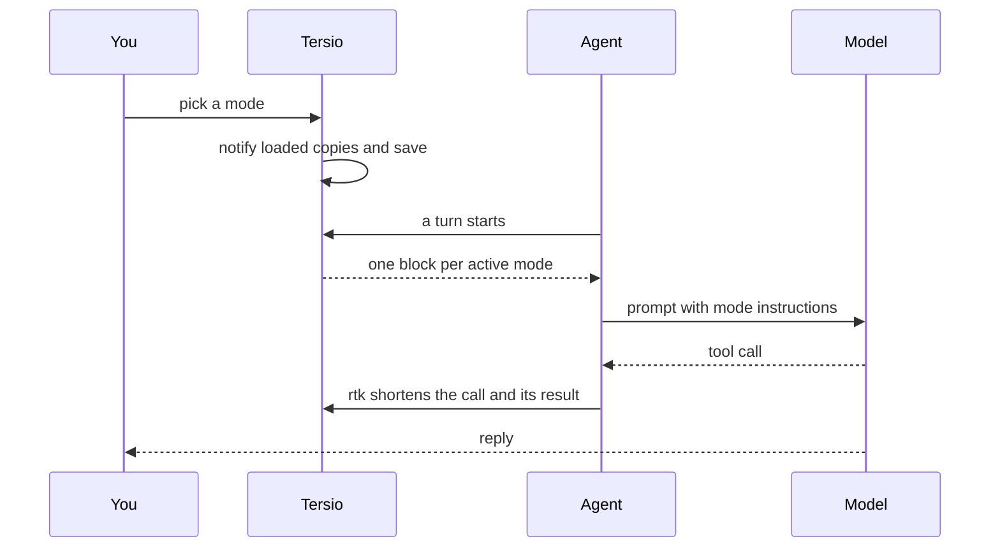
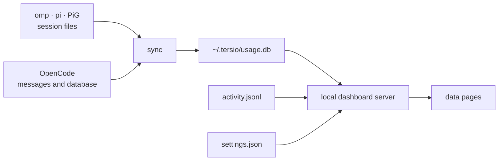
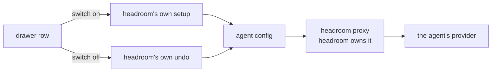

# Architecture

Tersio has two parts. The CLI installs and repairs. The plugin runs inside an agent. A local dashboard shows what the agents did.

## The parts

- **One release covers both parts.** The installed plugin and the CLI share a version.
- **The plugin starts no background service.** It runs only while the agent runs.
- **The dashboard mostly reads.** It writes saved mode defaults, its own layout and update preferences, and Headroom's setup through Headroom's own commands.

## How the plugin works

An agent loads the plugin at startup. A mode is one switch that changes one part of the work. Before each turn, the plugin adds one short instruction block for each active mode. The agent sends those instructions with your prompt. When the reply ends, the plugin waits for the next turn.

Inside the agent, a switch updates the running session and every loaded copy at once. The session record keeps the choice. The dashboard instead writes a saved default, which an agent reads when a session starts. Nothing restarts.

Say you pick `/combo balanced` and ask a question. Tersio saves the choice. At the next turn it adds the active blocks. A voice mode sets the reply style, an approach mode picks the checks, a tool mode shortens shell output, and a size mode caps the change. The model reads them with your request. The reply follows the same modes.

| Load order | Mode | What it controls | Plain effect |
|---|---|---|---|
| 1 | 🪨 caveman | Voice | Terse replies; code, paths, and errors stay exact |
| 2 | 🥔 pstack | Approach | Picks the playbook, the checks, and the design |
| 3 | 🍃 headroom | Transport | Tells the model how to recover compressed detail |
| 4 | 🗜️ rtk | Tool output | Rewrites shell commands and shortens what comes back |
| 5 | 🧠 ponytail | Size | Keeps the change as small as the task allows |

- **Load order is not priority.** No mode reads another mode's text. An inactive mode adds no block.
- **The blocks describe roles.** Caveman owns how a reply reads. Ponytail owns how much changes. Pstack owns the checks.
- **A switch replaces its own block.** Two levels of the same mode never stack.
- **Headroom adds nothing unless its runtime answers.** An undelivered promise would read as an active mode.

## The dashboard

- **One store feeds every page.** Overview, Models, Providers, Costs, Carbon, Requests, Errors, Traces, Tools, and Projects read the same store.
- **The server syncs before it reads.** A 15-second throttle keeps a page current without rereading every transcript on each poll.
- **History survives schema changes.** A new column backfills in place. An additive change never forces a rebuild from rotated transcripts.
- **Agent files stay agent-owned.** Tersio reads them and never writes to them. Reset statistics writes a watermark, not a delete.
- **Some facts stay with their source.** The omp quota view reads omp's own database. A trace reads the session file, because the store keeps facts, not message bodies.
- **One activity log, two writers.** The CLI and the dashboard append to `~/.tersio/activity.jsonl`, so a terminal install appears on the Logs page.

## Headroom

Headroom is a separate tool that compresses tool output, file reads, and history before a turn reaches the model. Tersio writes the same configuration headroom writes, through headroom's own commands. A switch starts headroom's runtime first, so an agent never points at a dead port. Headroom still owns the proxy and its settings.

- **Only detected tools appear.** Continue is discontinued, and ZCode keeps its settings in a desktop window, so both stay out.
- **The runtime comes before the switch.** Tersio starts headroom's saved deployment, or headroom's proxy when none exists, and waits for health. Dashboard start restores an enabled runtime. The Tools page also carries a Start Headroom action.
- **Only Oh My Pi and OpenCode are routed Tersio hosts.** pi, PiG, and DeepSeek Harness never receive a Headroom prompt, because their traffic has no Headroom route.
- **A row states its own path.** A switch means a durable setup Tersio manages. `headroom install` means headroom's installer owns it. `session only` means no durable setup exists.
- **Undo is always headroom's.** Tersio removes its own record only after `headroom unwrap` answers.
- **The pill states configuration, not traffic.** Headroom's own dashboard answers whether traffic actually reaches the proxy.

## Setup, update, and health

- **Install writes one tree per agent and one manifest.** A second copy of the same file is treated as the bug.
- **Doctor repairs or names the cleanup.** A partial tree reads as not installed. Legacy entries are removed.
- **Update checks two sources.** The npm registry and the GitHub release feed are read together, and the newer version wins.
- **The server owns the clock.** The page sends durations, not timestamps, so a waking laptop cannot show a stale window.
- **Nothing installs without a click.** Update now spawns `tersio update --yes` and prints the child's output.

Caveman, pstack, ponytail, and rtk are ports. `cli/upstream.ts` records a pin for each source and compares the local files with that pin. `tersio upstream` is a hidden engineering check: it reports gaps, separates reviewed drift from new drift, and writes Markdown only when `--md` names a file. No scheduled job runs it.

## MCP

`tersio mcp` serves the Model Context Protocol over stdio. Any compatible client can read Tersio's numbers and set its mode defaults.

- **The client starts it.** There is no daemon, port, or token.
- **It reads the same store as the dashboard.** A dashboard figure and an MCP figure are the same figure.
- **Its write path matches Settings.** A mode change lands in `settings.json` and in the activity log.
- **stdout carries only the protocol.** Settings output is captured and returned as the tool's answer.

## Limits

- **The shared state is process-wide.** One process serving two sessions would share it. The supported hosts run one user and one session per process.
- **Prompt blocks append.** A mode change replaces its own old block, but no extension can rewrite another mode's prompt text.
- **Agent detection is mostly by name.** An agent that rewrites its subagent prompt loses that detection silently.
- **A store from a newer Tersio is kept.** The older build skips the re-parse, because rotated transcripts cannot rebuild it.
