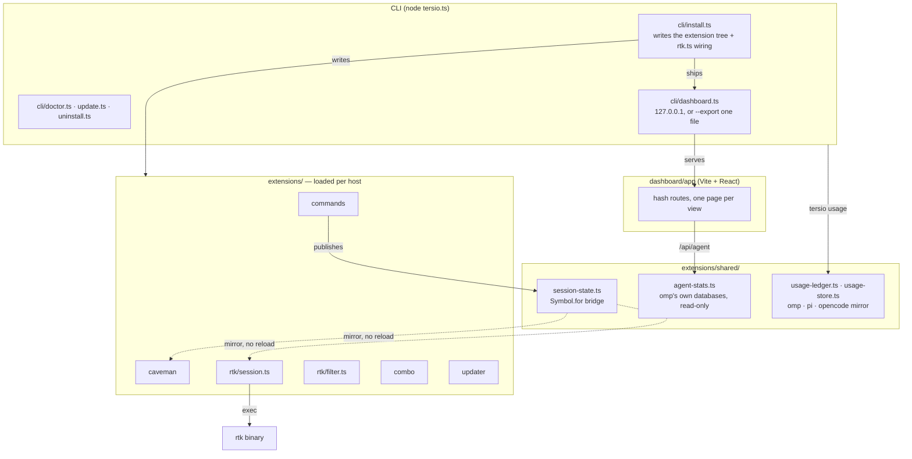
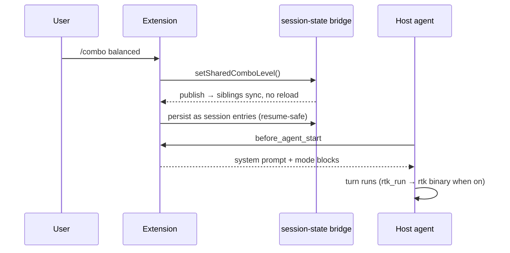
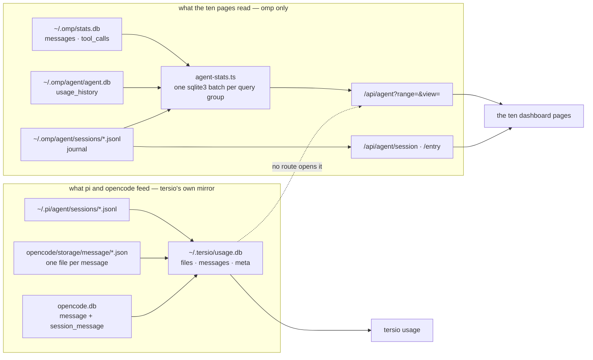

# Architecture

Tersio is one npm package with two faces: a **CLI** (`tersio install|update|doctor|dashboard…`) and a **host plugin** whose feature-gated extensions load inside any supported agent — omp, pi, or OpenCode. The CLI picks one with `--host`, every extension speaks one `ExtensionApi`, and all three read the same session defaults from one file. The reporting side is not yet that even, which the next section spells out.

## Components

## One turn

## Data sources, and the split between them

Two read paths. **They do not meet**, which is the single fact to hold onto.

- **The dashboard reads omp only.** `agent-stats.ts` opens `~/.omp/stats.db` and `~/.omp/agent/agent.db`, which only omp writes. Every one of the ten pages — Overview, Models, Providers, Costs, Carbon, Requests, Errors, Traces, Tools, Projects — and both transcript routes come out of those two files plus the omp journal.
- **pi and opencode land in the mirror, which no page reads.** `usage-ledger.ts` walks the pi sessions dir, the OpenCode JSON tree, and the OpenCode v2 sqlite, and `usage-store.ts` folds them into `~/.tersio/usage.db`. That store is read by `tersio usage` on the CLI and by nothing else: no dashboard route opens it, and the export snapshot carries no usage rows. So pi and opencode tokens, cost, tool names, duration, host, and main-versus-subagent kind are recorded and reportable, and invisible to the dashboard.
- **OpenCode has no trace at any price.** `readSessionTrace` bails on anything that is not `.jsonl`, and OpenCode writes one JSON per message or one sqlite row. The Traces page and its drawer therefore draw their empty state for an OpenCode session, while pi transcripts trace in full from the same reader.
- **The split is per row, not per page.** `usage.db` holds omp too, so an omp session appears in both the agent pages and `tersio usage`, and the two can disagree only by design: the agent pages price against omp's own cost columns, `tersio usage` against `extensions/shared/pricing.ts`.

## The aggregate

- **The aggregate mirrors the reference, metric for metric.** `readAgentStats(range, view)` reimplements the omp-stats SQL facts: `failed` counts only `stop_reason = 'error'`, `cacheRate` is `cacheRead / (input + cacheRead)`, and `avgTokensPerSecond` divides by `COUNT(duration > 0)`. The subscription-window engine ports the same rules: a window is one `(provider, limitId)` pair, consumption sums only positive fraction deltas, a drop past 0.05 counts a cycle, and the peak is the swept sum across accounts. Each rule is pinned by `test/cli/omp-stats.test.ts`.
- **A view asks for only what it renders.** `view=<page>` selects the query groups the server runs and the fields it returns, so a payload stays in the tens of kilobytes rather than one snapshot. Reads are memoized for five seconds per range and view.
- **Never a write.** Every read opens with `sqlite3 -readonly`. The WAL traps are handled in order: `-readonly` first, then `immutable=1` only when no `-wal` file exists, then a copy of `db` + `-wal` + `-shm` into a temp directory. Nothing opens read-write, which would create side files in the host's own directory.
- **Range is URL state.** Keys `1`-`6` pick a window and `g` then a letter opens a page. An exported file carries a single window, so its picker is a label, not a control.
- **Degrade by source.** A missing `stats.db` hides the six `agentOnly` pages — Providers, Costs, Carbon, Errors, Traces, Projects — and leaves Overview, Models, Requests, and Tools standing.
- **Two marks, two jobs.** `VendorMark` names the model author, resolved from the model id. `ProviderMark` names the routing service. Marks resolve to URLs from one catalog in `extensions/shared/brand-marks.ts`, never to bytes in the source; `--export` inlines that catalog once so an exported file keeps its logos with the network off.

## Key invariants

- **Bridge, not reload:** `session-state.ts` uses a `Symbol.for` global bridge; a toggle publishes and siblings mirror live. Custom session entries are the persistence layer — `reconcileSharedComboEntries` rebuilds state on resume or branch.
- **Subagents inherit:** `isOmpSubagentPrompt` makes subagent turns read shared state instead of local flags. Detection is text-based on `OMP_SUBAGENT_MARKER`, a verbatim sentence from the host prompt, so a reworded host drops it silently. pi has no built-in subagent prompt, so only omp is detectable by text.
- **Injection appends only:** a mode switch leaves the previous level's text in an accumulating prompt. Removing it needs host support to rewrite the system prompt, which an extension cannot reach.
- **Bridge state is process-global:** the `Symbol.for` bridge and `RTK_DISABLED` are unscoped, so one process serving two sessions would share them. Correct for the single-user hosts this targets.
- **Ledger is best-effort:** append-only JSONL; `tersio reset` writes a watermark instead of deleting host-owned files.
- **The mirror never discards a store from a newer tersio:** a `parser_version` above this build keeps its rows and skips the re-parse, because rotated transcripts cannot rebuild them. `TERSIO_FORCE_REPARSE=1` accepts the loss.
- **Always on:** `omp.extensions` in `package.json` loads every mode extension. Only `updater` stays an optional feature.
- **Single owner:** OMP plugin manifests load Tersio extensions and nested Ponytail. `config.yml` holds only rtk-owned wiring; doctor removes retired, duplicate, or legacy manifest-owned entries. An install removes the agent-tree copies an older build wrote, because a second load of the same file is the bug.
- **Caveman rule ownership:** `extensions/caveman/rule.md` ships beside the manifest-loaded extension. Doctor and updater inspect that installed plugin path, not the retired agent copy.
