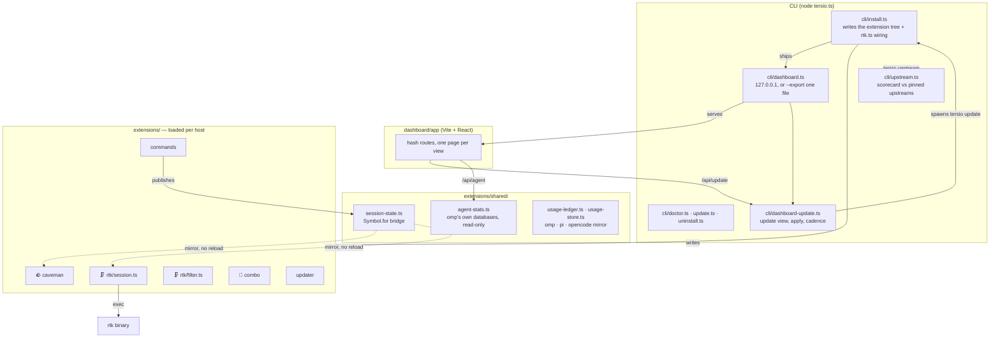
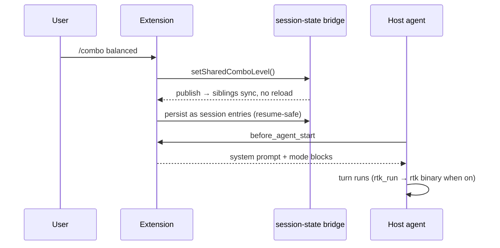
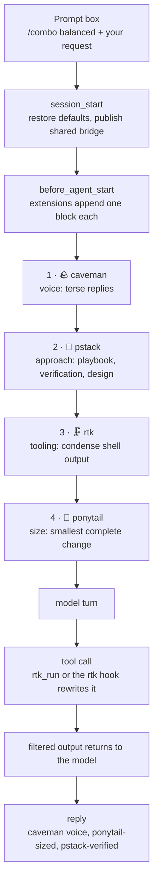
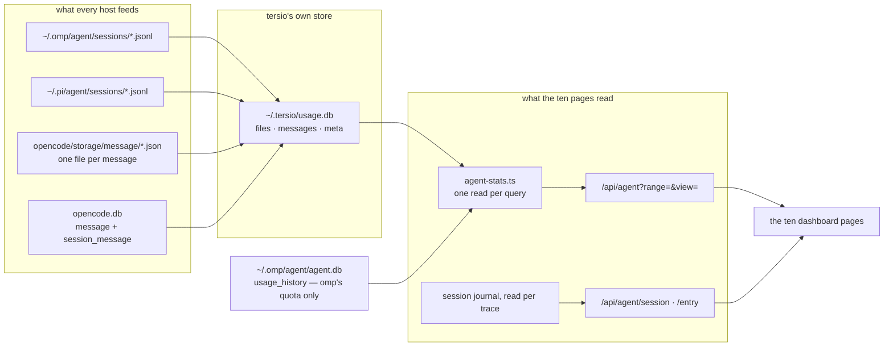
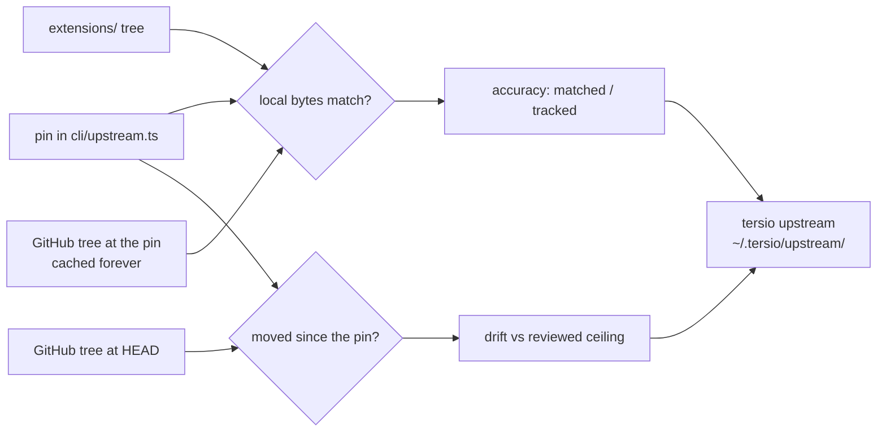
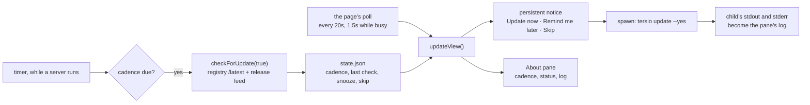

# Architecture

Tersio is one npm package with two faces: a **CLI** (`tersio install|update|doctor|dashboard…`) and a **host plugin** whose feature-gated extensions load inside any supported agent — omp, pi, or OpenCode. The CLI picks one with `--host`, every extension speaks one `ExtensionApi`, and all three read the same session defaults from one file. The reporting side is not yet that even, which the next section spells out.

## Components



## One turn



## Mode order: what comes first

Four modes stack on one turn. They never compete for the same job, so the order is fixed by what each one owns, and the prompt blocks are appended in the extension registration order.



The status line names the same four modes with the same glyphs. Its order is the display order, not the injection order:

```
🧩 COMBO MAX: 🪨 caveman=ULTRA | 🗜️ rtk=ON | 🧠 ponytail=ULTRA | 🥔 pstack=ON
```

- **The order is registration order, not priority.** `package.json` loads caveman, pstack, rtk, then combo, and combo injects the Ponytail block. A host that loads the same files in another order appends in that order, and no mode reads another's block.
- **caveman owns the voice.** It changes how a sentence reads, never what the work is.
- **pstack owns the approach.** It picks the playbook and the verification, and it yields the voice to caveman and the change size to ponytail.
- **rtk owns the tooling.** It rewrites a shell command and filters its output before the model sees it. It never edits a reply. On OpenCode the rewrite goes through `rtk hook opencode`, the same subcommand rtk's own OpenCode plugin calls, so a rewrite that would change what OpenCode's own permission rules decide is refused rather than applied.
- **ponytail owns the size.** It caps the diff, and it never overrides pstack's verification. Last is not weakest: ponytail is the YAGNI gate, and it holds the final say on how much gets built.
- **A conflict resolves inside the block text.** pstack's own precedence lines say so: the style mode wins on reply shape, and ponytail wins on how much changes.
- **Every block is append-only.** A mode switch replaces its own block through `staleMarker`, so a `/combo max` mid-session never stacks two levels of the same rule.


## Data sources, and the one store both readers share

One read path. **The aggregate and the report read the same store.**



- **One store feeds both readers.** `agent-stats.ts` opens `~/.tersio/usage.db`, the same file the ten pages aggregate. Every one of the ten pages — Overview, Models, Providers, Costs, Carbon, Requests, Errors, Traces, Tools, Projects — reads every host: omp, pi, and OpenCode. A dashboard figure and a report figure are the same figure by construction, not by coincidence.
- **The dashboard syncs before it reads.** `cli/dashboard.ts` runs `syncUsageDb()` behind a 15s throttle, so a page reads what the transcripts hold rather than what the last sync wrote. The 5s memo still collapses a burst of polls, keyed on the store's own mtime and size.
- **omp's quota snapshots stay omp's.** Only omp records `usage_history`, so the Providers page still reads `~/.omp/agent/agent.db` for it. Nothing in the store replicates them, and the page's window figures degrade to empty when that database is absent.
- **A trace is still a journal read.** `readSessionTrace` and `readAgentRequestEntry` open the session transcript itself, because the store keeps facts, not message bodies. OpenCode writes no `.jsonl`, so its traces keep drawing the empty state, while pi transcripts trace in full from the same reader.
- **What the store does not carry reads as a literal, never as an estimate.** omp's schema held a per-component cost split, a route name, a per-request premium count, and a service tier. The store holds none of these, so `COL` in `agent-stats.ts` maps each to `NULL`, or `''`, in one place: cost reads whole with no split, a route reads empty. The provider column is not stored either, so it derives from the model id's first segment, spelled the way the dashboard marks it. First-token latency *is* stored, in `tf`, and it is omp-only: pi and OpenCode record none, so their rows read null and their latency averages read null rather than zero, because a zero would draw a flat line and claim no wait at all.
- **Every host's tool names are read, from three shapes.** omp and pi transcripts name tools beside the message. OpenCode's v1 JSON tree names them in the message's `content` parts. OpenCode's v2 sqlite puts those parts inside a `data` blob that holds newlines and tabs, so the blob cannot be read through the CLI; the names are extracted inside SQL with `json_each` and `group_concat` instead, and land in the same `tools` list. A store written before that reader holds every OpenCode row at `[]`, so a version marker (`opencode_tools` in `meta`) widens the watermark scan to the whole table exactly once. That marker matters: bumping `PARSER_VERSION` instead rebuilds the store from whatever transcripts still exist, which silently drops the history of every rotated transcript — that is a far larger loss than the one the backfill repairs.
- **A tool call carries its own sizes and its own error flag.** The `tc` column holds one fact per call: the name, the argument bytes, the result bytes, and the error flag. Both sizes and the flag live on the `toolResult` line that follows the call, keyed by the call id, so `collectToolResults` reads the whole file before `classifySessionLine` pairs each call with its result. A row written before `tc` holds names only, and its sizes and errors read zero rather than a guess.
- **rtk's savings come from rtk's own history, and a failed read says so.** `readRtkGainByVerb` folds the `commands` table by leading verb, because the raw table is 7,095 distinct commands on this machine and the top 20 hold 98% of the bytes. A verb's rate is its own saved bytes over its own input, not a mean of per-command rates, and a negative saving stays negative. Every read carries `measured`: false means rtk's database was absent or unreadable, so a page prints "not measured" and never a zero that claims nothing was saved. A WAL database whose `-shm` file is gone cannot be opened read-only, so `sqliteRead` retries on a private copy.
- **An added column backfills itself, and a version bump does not.** Four store columns arrived after the first release: `id`, then `a`, then `tf`, then `tc`. Each one took a bare `ALTER TABLE ... ADD COLUMN`, which moves no row and forces no re-parse, so the existing history survives what a rebuild could not reconstruct from rotated transcripts. The new column then reads NULL on history, which a marker closes: `opencode_tools` widens the OpenCode watermark scan once so old rows gain their tool names, and `ttft_backfill` clears the `files` mtimes once so the ordinary incremental path rewrites each transcript and fills its latency. `tool_facts` rides that same rewrite, because `tc` is written by the same parse. Every marker is written only after the rows commit, so a sync that dies midway leaves the window open and retries instead of publishing half a backfill. The rule: an additive change never justifies a `PARSER_VERSION` rebuild.
- **The request log ships one capped page, and the page's totals come from the aggregate, not from that page.** A log slice cannot answer "how many requests ran in this window": the cap is 200 rows, and a busy hour produces thousands. So `requestStats` takes its count, failure count, tokens and cost from the `overall` block, which is one exact aggregate row over the whole range, and leaves only the percentiles and the aborted count to the shipped rows. `shipped` records how many those were, and the page labels them, because a p95 over 200 of 2,400 rows describes those 200 only. `?offset=` walks the range back in row-sized steps — the alternative, computing the header from the shipped rows, is what made a full range read as exactly 200 requests with nothing older than an hour reachable.
- **Bucketing needs a cast.** The store keeps timestamps REAL, and a REAL division does not floor, so the bucket expression casts to INTEGER first. Without the cast every row lands in its own bucket and a series reads as noise.

## The aggregate

- **The aggregate mirrors the reference, metric for metric.** `readAgentStats(range, view)` reimplements the omp-stats SQL facts: `failed` counts only `stop_reason = 'error'`, `cacheRate` is `cacheRead / (input + cacheRead)`, and `avgTokensPerSecond` divides by `COUNT(duration > 0)`. The subscription-window engine ports the same rules: a window is one `(provider, limitId)` pair, consumption sums only positive fraction deltas, a drop past 0.05 counts a cycle, and the peak is the swept sum across accounts. Each rule is pinned by `test/cli/omp-stats.test.ts`.
- **A view asks for only what it renders.** `view=<page>` selects the query groups the server runs and the fields it returns, so a payload stays in the tens of kilobytes rather than one snapshot. Reads are memoized for five seconds per range and view.
- **Never a write.** Reads run in process (bun:sqlite, else node:sqlite) and fall back to the `sqlite3` binary, whose WAL traps `extensions/shared/sqlite.ts` handles in order: `-readonly` first, then `immutable=1` only when no `-wal` file exists, then a copy of `db` + `-wal` + `-shm` into a temp directory. Nothing opens read-write, which would create side files in the host's own directory.
- **Range is URL state.** Keys `1`-`6` pick a window and `g` then a letter opens a page. An exported file carries a single window, so its picker is a label, not a control.
- **Degrade by source.** A missing `stats.db` hides the six `agentOnly` pages — Providers, Costs, Carbon, Errors, Traces, Projects — and leaves Overview, Models, Requests, and Tools standing.
- **Two marks, two jobs.** `VendorMark` names the model author, resolved from the model id. `ProviderMark` names the routing service. Marks resolve to URLs from one catalog in `extensions/shared/brand-marks.ts`, never to bytes in the source; `--export` inlines that catalog once so an exported file keeps its logos with the network off.

## The upstream scorecard

Every mode Tersio ships is a port. `cli/upstream.ts` holds one pin per source and answers two questions: do our bodies still match the pin, and has upstream moved past it.

| Source | Pin | What is compared |
|---|---|---|
| Caveman | `JuliusBrussee/caveman` commit `d262ab3` | Three bodies byte for byte, after the one adapted line; three local forks by presence |
| pstack | `cursor/plugins` commit `a968159` | Every shipped body by presence; every body is a fork with Cursor's surface removed |
| Ponytail | the vendored copy at `extensions/ponytail/`, its version read from that tree's own manifest | Each host's copy against that tree; npm's `latest` tag for upstream drift |
| RTK | `rtk-ai/rtk` release feed | The binary's `--version` against the latest release tag |



- **A pin is reviewed, not guessed.** `driftCeiling` records how much drift was already reviewed when the pin was taken, so `--strict` fails on new drift rather than on the known backlog.
- **A commit's tree is cached until it is not read for 30 days; HEAD for six hours.** `~/.tersio/upstream/trees/` holds the immutable trees, so a rerun costs one API call per repo. A token from `GITHUB_TOKEN`, `GH_TOKEN`, or `gh auth token` lifts the 60-call hourly limit. A cached tree still serves the comparison when the live read fails, but the failure is reported, so a rate-limited run never reads as a clean one.
- **A failed read says which failure it was.** A 404 on the pin is `pin-missing`, a 403 or 429 is `offline`, anything else is `error`. A pin that is gone fails even a plain `--check`, because a zero-tracked row would otherwise keep accuracy at 100 and pass on nothing.
- **Every gap is named, and grouped by whose move it was.** The report lists `ours to fix` (a body of ours absent, empty, or differing, and each stale or missing host file), `upstream moved` (paths changed, added, or gone since the pin, with a compare URL for the pin), and `unmeasured` (a source whose feed could not be read). The terminal folds a group at 12 names; the Markdown report keeps all of them.
- **A declared fork matches by presence.** pstack's 91 bodies all had Cursor's surface stripped, so no byte comparison exists; the scorecard proves each is shipped and non-empty, and reports upstream drift separately.
- **Accuracy covers the installed hosts too.** A host's tree is compared to this build's own definition, so a stale or missing file lowers the score even when every source matches.
- **A host's manifest is checked as well as its files.** The `Unloaded` column counts entries this build loads that the host's own manifest never names, because a file can sit in the tree and still never run. The manifest is read only where the host keeps one.
- **Drift is not a failure.** A plain run only reports. `--check` fails on any gap of ours, and `--strict` implies it, then adds drift past the ceiling plus an unmeasured drift, so a rate-limited run never passes silently.
- **The command is hidden, and it writes a report.** `tersio upstream` is not listed in `tersio help`, because it is an engineering check, not a user command. It writes `~/.tersio/upstream/scorecard.json` for machines and `~/.tersio/upstream/scorecard.md` for a reader: tables, a text bar per source and host, and an `xychart-beta` Mermaid graph. `--md <file>` writes the report elsewhere.
- **No scheduled job.** The scorecard runs when someone runs it. A weekly CI job was tried and removed: it needs a token, it goes red on reviewed drift, and the same answer is one local command away.

## The dashboard update surface

`cli/dashboard-update.ts` owns the update state, and `cli/dashboard.ts` only routes to it. The page polls one view, so the notice and the About pane cannot disagree.



- **The check reads two sources, not one.** The registry's `latest` tag and the GitHub release feed are fetched side by side, and the newer version wins. A tag can be pushed before npm serves it, so a check that read only npm missed releases that already existed. A tie goes to npm, because that version is the one an install can reach. The plan names the source when they disagree.
- **The server owns the clock.** The page sends no timestamps: `dueIn` and `snoozeIn` arrive as durations, so a laptop waking from sleep cannot show a stale window, and the render calls no clock.
- **The timer only exists while a dashboard runs.** Both timers are `unref`d, so they never hold the process open, and the cadence resumes on the next launch. A check stamps `lastCheck` even when no source answers, so an offline machine retries on its cadence rather than on every tick.
- **Applying spawns this CLI's own update path**, `tersio update --yes`, as a child with both streams captured. The smoke check before an install, the global CLI refresh, and the add-on pass therefore stay in one place, and the child's output is what the pane prints. Nothing about the release is taken from the request body.
- **`current` is read from the installed manifest, `running` from this process.** An install moves `current` while the old build keeps serving, so the pane can say a reload is what finishes the job, and the notice stops offering a release already on disk.
- **The notice is one toast per concern**, keyed by id: a poll that finds the same release 60 times replaces the same toast instead of stacking 60.
- **Skip is per release, snooze is per window.** Skipping retires the version named and nothing later; a snooze hides the notice for six hours and lapses on its own.
- **Nothing installs without a click.** The cadence only asks the sources; the apply path is the notice's `Update now` or the pane's `Update to X`.

## Key invariants

- **Bridge, not reload:** `session-state.ts` uses a `Symbol.for` global bridge; a toggle publishes and siblings mirror live. Custom session entries are the persistence layer — `reconcileSharedComboEntries` rebuilds state on resume or branch.
- **Subagents inherit:** `isOmpSubagentPrompt` makes subagent turns read shared state instead of local flags. Detection is text-based on `OMP_SUBAGENT_MARKER`, a verbatim sentence from the host prompt, so a reworded host drops it silently. pi has no built-in subagent prompt, so only omp is detectable by text.
- **Injection appends only:** a mode switch leaves the previous level's text in an accumulating prompt. Removing it needs host support to rewrite the system prompt, which an extension cannot reach.
- **Bridge state is process-global:** the `Symbol.for` bridge and `RTK_DISABLED` are unscoped, so one process serving two sessions would share them. Correct for the single-user hosts this targets.
- **Ledger is best-effort:** append-only JSONL; the dashboard's Reset statistics writes a watermark instead of deleting host-owned files.
- **The mirror never discards a store from a newer tersio:** a `parser_version` above this build keeps its rows and skips the re-parse, because rotated transcripts cannot rebuild them. `TERSIO_FORCE_REPARSE=1` accepts the loss.
- **Always on:** `omp.extensions` in `package.json` loads every mode extension. Only `updater` stays an optional feature.
- **Single owner:** OMP plugin manifests load Tersio extensions and nested Ponytail. `config.yml` holds only rtk-owned wiring; doctor removes retired, duplicate, or legacy manifest-owned entries. An install removes the agent-tree copies an older build wrote, because a second load of the same file is the bug.
- **The plugin package and the CLI are one release.** `~/.omp/plugins/package.json` pins `@krtclcdy/tersio` to the exact version, because a range lets npm hand omp a release the tree writer never wrote, and a tree of two releases fails to load.
- **Caveman rule ownership:** `extensions/caveman/rule.md` ships beside the manifest-loaded extension. Doctor and updater inspect that installed plugin path, not the retired agent copy.
